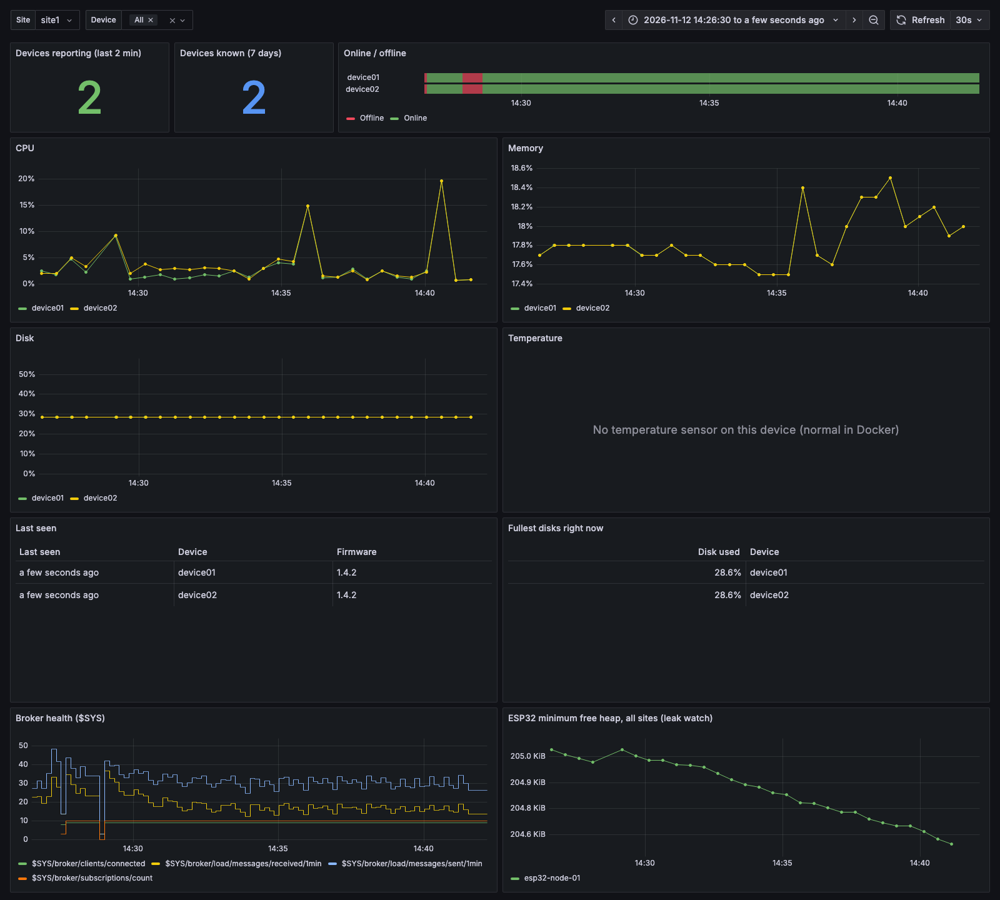

# MQTT IoT Monitoring with Mosquitto, Telegraf, InfluxDB and Grafana

A self-hosted, fully open-source MQTT monitoring stack for IoT devices. Everything runs in Docker,
so you can try the complete setup on one machine before pointing real Raspberry Pis, gateways or ESP32s at it.

- **Device telemetry**: CPU, memory, disk, temperature, plus Raspberry Pi throttling, under-voltage and SD-card health
- **Offline detection**: retained Last Will and Testament, heartbeat timeouts, reboot detection, site-outage grouping
- **Dashboards**: a provisioned Grafana dashboard with site/device filters, an online/offline timeline and broker health
- **Pi gateway demo**: a local Mosquitto that bridges a site's devices (a simulated ESP32) to the central broker



Companion code for the SocketXP blog series:

- [MQTT IoT Monitoring: Track Device Health, Telemetry and Offline Status](https://www.socketxp.com/iot/mqtt-iot-monitoring)
- [Detect Offline IoT Devices with MQTT Last Will and Heartbeats](https://www.socketxp.com/iot/mqtt-device-offline-detection-last-will-heartbeat)
- [MQTT Grafana Dashboard with Mosquitto, Telegraf and InfluxDB](https://www.socketxp.com/iot/mqtt-grafana-dashboard-mosquitto-telegraf-influxdb)
- [Monitor Raspberry Pi and ESP32 Devices with MQTT](https://www.socketxp.com/iot/raspberry-pi-esp32-mqtt-monitoring)

## Architecture

```
 device01 ─┐                                   ┌──► Telegraf ──► InfluxDB ──► Grafana :3000
 device02 ─┼─ MQTT ─► Mosquitto (central) :1883┤
 device03 ─┘              ▲                    └──► watchdog (offline / stale / rebooted / site-outage alerts)
                          │ bridge (fleet/site3/#)
 esp32-sim ─ MQTT ─► gateway (Pi site gateway, profile "gateway")
```

Topics follow `fleet/{site}/{device_id}/{telemetry|status|event|alerts}`.

## Quick start

Requirements: Docker with Compose v2.

```bash
git clone --depth 1 https://github.com/ampaslabs/socketxp-blog-tutorials.git
cd socketxp-blog-tutorials/mqtt-iot-monitoring
cp .env.example .env          # then change every password and the InfluxDB token
./scripts/setup.sh            # creates Mosquitto password files and the gateway bridge config
docker compose up -d          # add `--profile gateway` to include the Pi gateway + simulated ESP32
```

Open Grafana at <http://localhost:3000> and log in as `admin` with `GRAFANA_ADMIN_PASSWORD` from `.env`.
The **MQTT IoT Fleet** dashboard is set as the home page (it's also under **Dashboards → IoT Fleet**).
Give it a minute after startup for the charts to fill in. The Temperature panel stays empty in Docker,
because containers have no CPU temperature sensor; it fills in on a Raspberry Pi.

Watch the raw MQTT traffic:

```bash
source .env
docker compose exec mosquitto mosquitto_sub -u watchdog -P "$MQTT_WATCHDOG_PASSWORD" -t 'fleet/#' -v
```

Get a fleet snapshot from the retained status messages (exits after 3 seconds of silence):

```bash
docker compose exec mosquitto mosquitto_sub -u watchdog -P "$MQTT_WATCHDOG_PASSWORD" \
  -t 'fleet/+/+/status' -v -W 3
```

## Try the failure scenarios

| What to do | What happens |
|---|---|
| `docker compose stop device01` | Agent publishes `offline` itself (clean shutdown); watchdog alerts after the 60 s grace period |
| `docker compose kill device02` | Broker publishes the Last Will `offline` immediately (connection closed without DISCONNECT) |
| `docker compose pause device03` | Nothing is sent; broker publishes the Last Will after ~90 s (1.5 × 60 s keepalive) |
| `docker compose --profile gateway kill gateway` | Bridge topic `fleet/site3/pi-gw-01/bridge` turns `0`; the ESP32 still shows `online`, but the watchdog flags it as stale |
| `./tests/run.sh hung` | App hangs while the MQTT connection stays up: no Last Will, but the heartbeat watchdog alerts |
| `./tests/run.sh reboot` | Uptime goes backwards: `rebooted` alert |
| `./tests/run.sh site` | 4 devices at one site drop together: one `site-outage` alert instead of four |
| `./tests/run.sh willdelay` | MQTT 5 Will Delay: an 8 s blip publishes nothing; a real outage publishes `offline` ~20 s later |

Alerts are published to `fleet/{site}/{device}/alerts` and `fleet/{site}/alerts`, and printed in
`docker compose logs -f watchdog`. Set `WEBHOOK_URL` in `.env` to also send them to Slack, Teams or any JSON webhook.

Bring stopped devices back with `docker compose unpause device03` / `docker compose start device01 device02`.

## Use it with real devices

**Raspberry Pi or any Linux device**: copy `device/device_agent.py` and `device/pi_metrics.py` to the device and run it
as a systemd service (full unit file in the Raspberry Pi article):

```bash
python3 -m venv venv && venv/bin/pip install -r requirements.txt
MQTT_HOST=<broker> SITE=site1 DEVICE_ID=pi-01 MQTT_PASSWORD=<password> venv/bin/python device_agent.py
```

Add the device to the broker first:

```bash
docker compose exec mosquitto mosquitto_passwd -b /mosquitto/config/passwd pi-01 '<password>'
docker compose kill -s HUP mosquitto     # reload credentials
```

**ESP32**: flash the Arduino sketch from the Raspberry Pi / ESP32 article. It publishes the same JSON as
`device/esp32_sim.py`, so the dashboard and watchdog work unchanged.

**Pi site gateway**: use `gateway/mosquitto.conf.template` on the Pi. Point `address` at your central broker
(TLS on port 8883 with `bridge_cafile`) and allow the gateway user to publish `fleet/<site>/#`.

## Before you use this in production

This repo is tuned for a local demo. For a real fleet:

- Give **every device its own password** (the demo devices share one), or better, X.509 client certificates (mTLS on port 8883)
- **Don't expose port 1883 to the internet.** Use TLS, a VPN, or a tunnel such as SocketXP so devices behind NAT/CGNAT reach the broker without open inbound ports
- Keep Grafana bound to `127.0.0.1`; share it with `socketxp connect http://localhost:3000` or a reverse proxy with TLS
- Pin image versions and back up the `influxdb-data` and `grafana-data` volumes
- Set retention to match your needs and add the 5-minute downsampling task from the Grafana article

## Repository layout

```
docker-compose.yml            the stack, simulated devices and the optional gateway profile
.env.example                  passwords and tokens (copy to .env)
scripts/setup.sh              creates Mosquitto password files + gateway bridge config
mosquitto/config/             central broker config and topic ACLs
telegraf/telegraf.conf        MQTT → InfluxDB: telemetry, status (1/0), events, $SYS broker metrics
grafana/provisioning/         InfluxDB data source + dashboard provider
grafana/dashboards/           the MQTT IoT Fleet dashboard
device/device_agent.py        device health agent (Linux / Raspberry Pi)
device/pi_metrics.py          Raspberry Pi throttling, under-voltage, Wi-Fi RSSI, read-only root FS
device/esp32_sim.py           simulated ESP32 (same payloads as the Arduino sketch)
watchdog/watchdog.py          offline / stale / reboot / site-outage alerts
gateway/                      Pi site gateway: local broker + bridge to the central broker
tests/                        failure scenarios
```

## Tested with

Docker 24 / Compose 2.18 on macOS (Apple silicon), eclipse-mosquitto 2.1.2, Telegraf 1.32, InfluxDB 2.7,
Grafana 11.3.0, Python 3.12, paho-mqtt 2.1.0, psutil 6.1.0.
